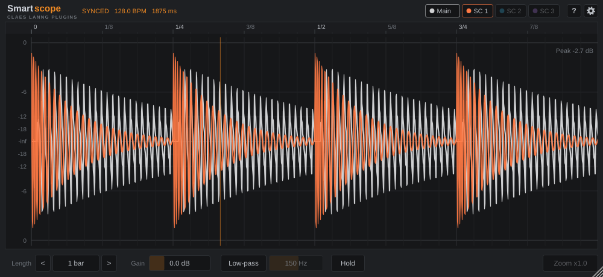
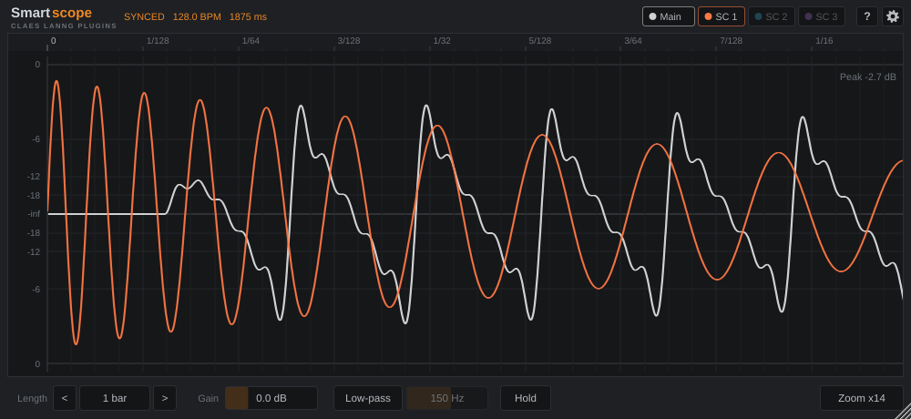
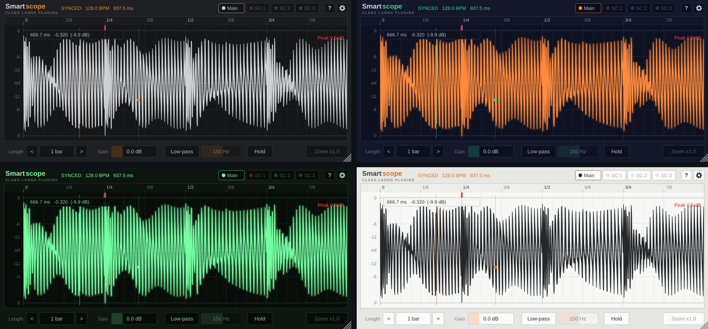
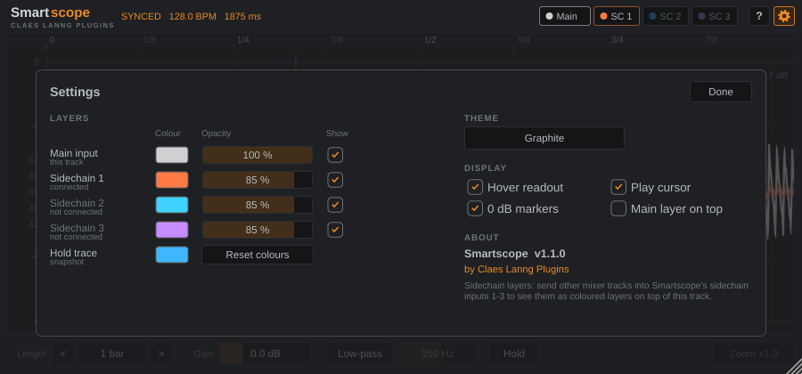

<h1 align="center">Smartscope</h1>

<p align="center">
  <b>A tempo-synced oscilloscope for checking that your kick and bass are in phase.</b><br>
  VST3 · Windows · by Claes Lanng Plugins
</p>

<p align="center">
  <a href="https://github.com/claeslanng/Smartscope/releases/latest"></a>
  <a href="https://github.com/claeslanng/Smartscope/actions/workflows/build-windows.yml"></a>
  
  
</p>

<p align="center">
  
</p>

---

## Download

Get the latest **`Smartscope-vX.Y.Z-Windows-VST3.zip`** from the [Releases page](https://github.com/claeslanng/Smartscope/releases/latest).

1. Unzip it.
2. Copy the `Smartscope.vst3` folder to `C:\Program Files\Common Files\VST3\`.
3. Rescan plugins in your DAW. In FL Studio: *Options → Manage plugins → Find more plugins*.

The plugin passes audio through unchanged, so it's safe on any track or on the master.

## Features

| | |
| --- | --- |
| **Tempo sync** | Locks to your DAW's tempo and song position. The window always starts on the beat and stays still while you loop. |
| **Window length** | 1/16, 1/8, 1/4, 1/2, 1 bar, 2 bars, 4 bars. |
| **Phase-friendly scale** | One combined trace (L+R) on a linear scale with dB labels. You can see polarity, so it's obvious when kick and bass push against each other. |
| **Sample-level zoom** | Zoom right in to individual samples. The grid switches from note values to milliseconds. |
| **Sidechain layers** | Route up to three other tracks into Smartscope and see each as its own coloured layer. Typical use: kick over bass. |
| **Display low-pass** | Shows only the low end. It doesn't touch the audio, adds no phase shift or delay, and redraws instantly even when playback is stopped. |
| **Hold** | Keeps a snapshot as a reference trace. Nudge the bass, then compare. |
| **0 dB markers** | Red ticks show where the signal goes above 0 dBFS. |
| **Hover readout** | Time from the start of the window in ms, plus the sample's value, sign and level. |
| **Themes and colours** | Four themes, plus your own colour and opacity for every layer. Saved with the project. |

<p align="center">
  
  <br><sub>Zoomed in: the bass (grey) starts about 18 ms after the kick (orange).</sub>
</p>

## Sidechain layers in FL Studio

1. Put Smartscope on the mixer track you want to look at, for example the bass.
2. Select the source track, for example the kick. Then right-click the small arrow under Smartscope's track and choose **Sidechain to this track**.
3. In Smartscope's plugin window, click FL's gear (*Detailed settings*), open **Processing**, and under *Connections* set **Sidechain 1** to the source track's number.
4. The **SC 1** chip in Smartscope's header lights up and the kick appears as a coloured layer. Repeat for Sidechain 2 and 3.

Click a chip in the header to show or hide that layer. Colours and opacity are in **Settings**.

## Mouse

| Over the display | Does |
| --- | --- |
| Wheel | Zoom in/out around the mouse |
| Shift + wheel (or horizontal swipe) | Scroll |
| Ctrl + wheel | Display gain |
| Alt + wheel | Window length |
| Drag | Pan |
| Double-click | Reset zoom |

When the transport is stopped, the scope free-runs at the project tempo while there is signal. When the signal goes silent, it keeps the last picture, so you can still zoom and filter it.

## Themes and settings

<p align="center">
  
  <br><sub>Graphite · Midnight · Phosphor · Daylight</sub>
</p>

The gear button opens **Settings**:
- Theme.
- Colour picker and opacity for each layer and for the Hold trace.
- Display options: hover readout, play cursor, 0 dB markers, main layer on top.

<p align="center">
  
</p>

## Building from source

Requires CMake 3.22+ and a C++17 compiler (Visual Studio on Windows). JUCE 8 is downloaded automatically.

```sh
cmake -B build
cmake --build build --config Release --target Smartscope_VST3
```

The plugin ends up in `build/Smartscope_artefacts/Release/VST3/`.

There's also an offline test that feeds synthetic audio through the plugin with a fake host. It checks the tempo sync and renders screenshots of the UI:

```sh
cmake -B build -DSMARTSCOPE_BUILD_TESTS=ON
cmake --build build --config Release --target RenderTest
```

### Releases

Every push builds the plugin on GitHub Actions. Pushing a version tag publishes a Release with the zipped plugin, using the matching section of [CHANGELOG.md](CHANGELOG.md) as the release notes:

```sh
git tag v1.2.0
git push origin v1.2.0
```

### Project layout

```
Source/
  PluginProcessor.*   audio capture: tempo sync, window buffer, sidechain layers
  ScopeView.*         waveform drawing, grid, zoom, display low-pass, hold
  PluginEditor.*      window, header and footer controls, look-and-feel
  SettingsPanel.*     themes, layer colours, display options, about
  Themes.h            colour themes
  UISettings.h        saved display preferences
Tests/RenderTest.cpp  offline sync checks and UI renders
docs/images/          screenshots used in this README
```

## Changelog

See [CHANGELOG.md](CHANGELOG.md).

---

<p align="center"><sub>Made by <b>Claes Lanng Plugins</b> · built with <a href="https://juce.com">JUCE</a></sub></p>
